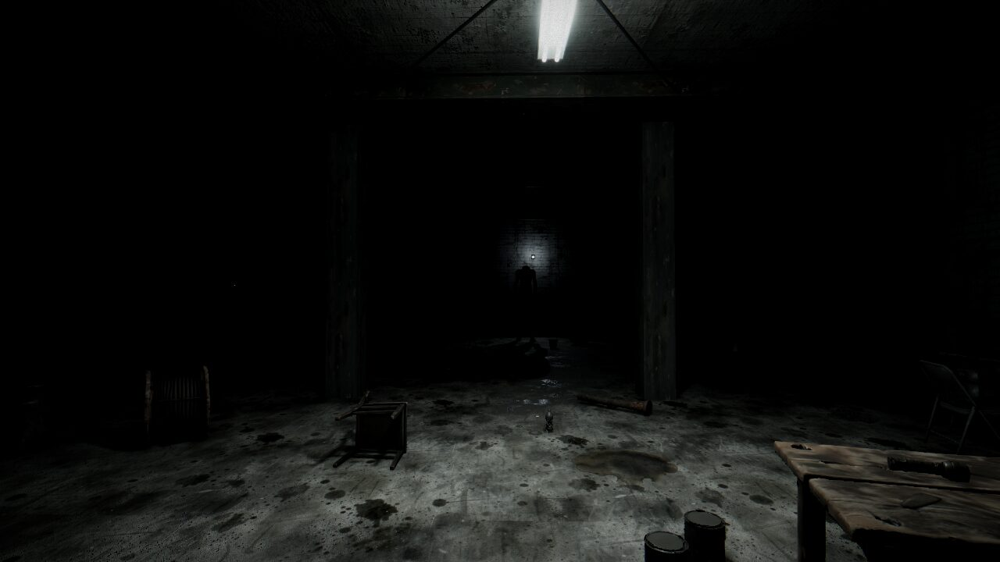
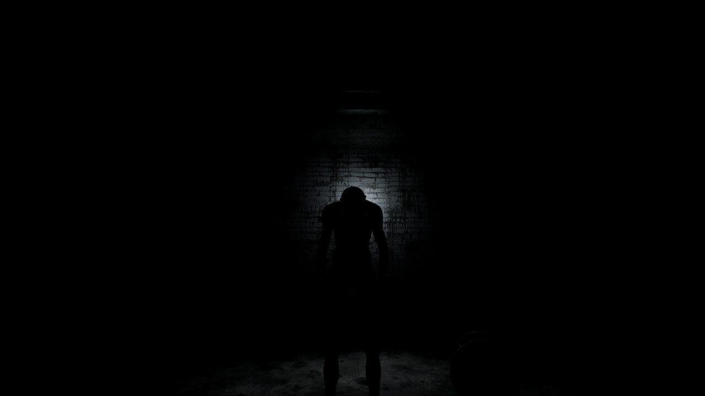
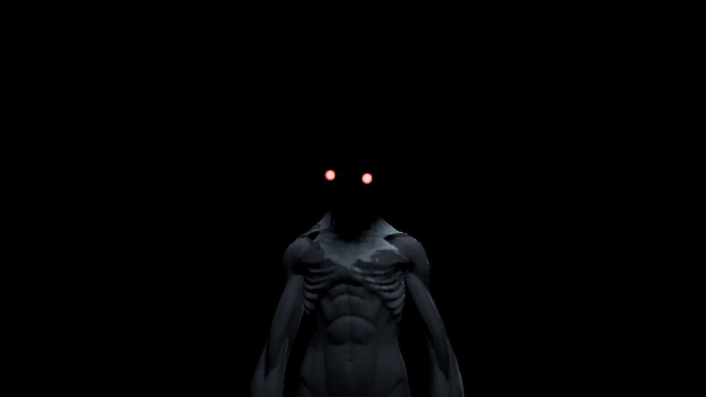
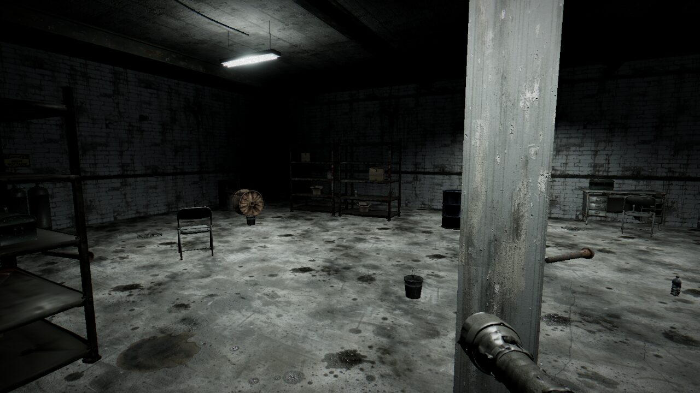

# DON'T LOOK AWAY

*By Phatty Acid Generative Studios*

A short (1–3 minute), cinematic first-person horror game for desktop browsers.
You wake up in a dark industrial storage room. At the far end stands a tall figure,
head hanging, perfectly still. Find the flashlight, find the batteries, restore the power.
Every time it leaves your field of view, it gets closer.

| | |
| --- | --- |
|  |  |
|  |  |

## Play

```bash
npm install
npm run dev        # http://localhost:5173
npm run build      # production build in dist/
npm run preview    # serve the production build
```

Best with headphones, in a dark room. Works with mouse and keyboard, or on phones and tablets with touch controls
(left thumb: floating joystick, right thumb: drag to look, on-screen E and flashlight buttons). Nearby interactable objects show a marker; it turns into an **E** badge when you are in reach.

| Input | Action |
| --- | --- |
| `W A S D` | Move (slow, deliberate; no sprint, no jump) |
| Mouse | Look |
| Arrow keys | Look around (left/right turn, up/down tilt) |
| `E` | Interact (hold on the breaker) |
| `F` | Toggle the flashlight (it switches on by itself once it has batteries) |
| `Esc` | Pause / release the mouse |

## Deploy (Netlify)

`netlify.toml` is included: build command `npm run build`, publish directory `dist`, Node 22.
Connect the GitHub repository in Netlify and deploy the default branch; no environment variables needed.

## How it works

- **Rendering**: Three.js via React Three Fiber, physically based lighting, PCF shadows from the
  flashlight / fluorescent tube / caged practical bulb, a projected light cookie for the flashlight,
  an additive volumetric beam, light-reactive dust motes, exponential fog and a post-processing
  stack (N8AO ambient occlusion on High, mip-map bloom, depth of field in cinematics, ACES tone curve,
  film grain, vignette, subtle chromatic aberration). Adaptive resolution via `PerformanceMonitor`.
- **Physics**: Rapier (WASM). The player is a kinematic character controller that pushes light
  props; chairs scrape, cans roll, boxes slide, impacts make noise.
- **The creature** (`src/creature/`): a Meshy-generated, auto-rigged mesh that is posed procedurally
  (hanging head, long arms, stretched neck/limbs), with a skin-weight mask that turns the whole head
  into a featureless void and emissive eyes that only appear in the death cinematic.
  - `VisibilityDetector.ts` samples 11 points over its silhouette and tests them against the camera
    frustum (with a conservative margin) and occluders (pillars).
  - `CreatureAI.ts`: about 0.8 s after it leaves your view it steps straight toward you (longer
    strides from far away, shorter up close), and keeps stepping every ~1 s while you look away.
    Seen from the player every point on that line has the same bearing, so the new spot is out of
    view too; visibility is re-checked anyway. It never moves while observed.
  - Walking into it while watching triggers a proximity event (the hum drains away, a pressure tone
    rises, movement slows) and then the death cinematic. If it reaches you unseen, a brief sound
    warns you a split second before it does.
- **Audio**: Web Audio API with HRTF spatialization, a synthetic concrete-room convolution reverb,
  muffling for the death sequence, distance-driven tension layers (breathing, heartbeat, strings)
  and seamless loops.
- **Cinematics**: the death sequence (control loss, blackout, over-the-shoulder shot, slow orbit,
  unnatural head raise, red eyes, bloom, fade to black) and the victory sequence (breaker, strobing
  ballasts, failure, full illumination, the creature is gone) are timeline-driven in `src/cinematics/`.

Tuning values (speeds, creature timing, light levels, cinematic beats) live in `src/config/gameConfig.ts`;
the room layout lives in `src/config/layout.ts`.

## Asset pipeline

All assets were generated on [fal.ai](https://fal.ai) and post-processed by the scripts in `tools/assets/`
(the raw downloads are not committed). To regenerate you need a `FAL_KEY` environment variable.

| Script | What it does |
| --- | --- |
| `gen_models.py` | 27 props with **Tripo P2** (PBR textures), the creature with **Meshy 7.1** (auto-rigged) |
| `gen_textures.py` | Concrete / block / metal / wood surfaces and decals with **FLUX 3** |
| `gen_audio.py` | Music with **ElevenLabs Music v2.5** (and Lyria 3.5), 40+ sound effects with **ElevenLabs SFX v2** |
| `process_models.mjs` | glTF-Transform cleanup: simplify, weld, WebP textures, real-world scale, orientation, bottom-center pivot, meshopt compression |
| `process_creature.mjs` | Keeps the skeleton, compresses textures and geometry |
| `process_textures.py` | Makes surfaces tileable and derives normal / roughness maps; turns decals into alpha textures |
| `process_audio.py` | Loudness normalization, crossfaded seamless loops, footstep slicing |

## Tests

```bash
npm test                                   # unit tests: visibility + creature AI rules
npm run dev &                              # then, in another shell:
node tests/e2e/playthrough.mjs all         # full playthroughs in headless Chromium
```

The end-to-end suite drives the real game through a debug API (enabled with `?debug`): it plays the
full victory path, dies by walking into the creature, dies by turning your back on it, checks that it
never repositions while observed (including a 360° sweep), and checks that retrying resets the run.
